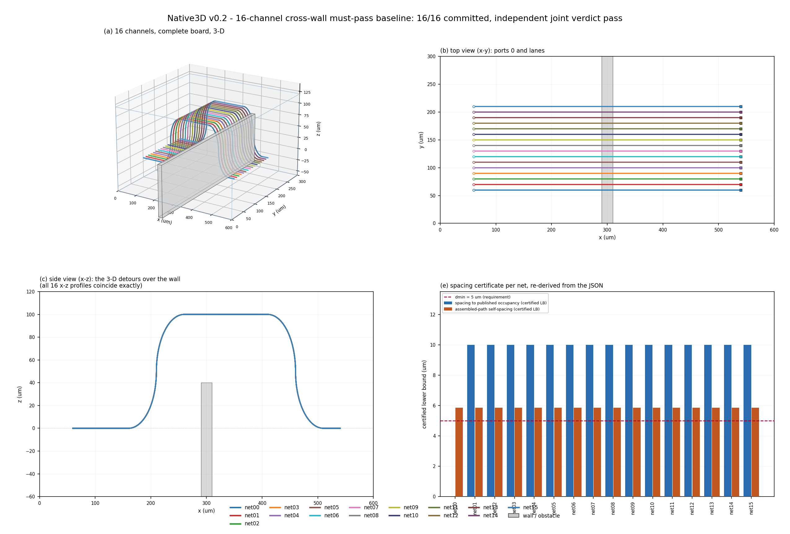

# OpticalWaveguideRouterNative3D

面向 **1024-channel native 3D optical waveguide router** 的科研原型。

当前完成 **v0.2：2 / 4 / 8 / 16 通道顺序布线基线**。路径从搜索开始就在 `(x,y,z,三维方向)` 空间产生；使用有限三维图和 A*，已提交波导成为后续通道的固定占用硬约束。



## 当前结果与范围

| 案例 | 请求通道 | 找到候选 | 合法并提交 |
| --- | ---: | ---: | ---: |
| crosswall_02 | 2 | 2 | 2 |
| crosswall_04 | 4 | 4 | 4 |
| crosswall_08 | 8 | 8 | 8 |
| crosswall_16 | 16 | 16 | 16 |
| stress_swap_04 | 4 | 4 | 0 |
| stress_swap_08 | 8 | 6 | 5 |

16 通道跨墙案例总长度 **9506.548246 μm**，每网 **594.159265359 μm**，z 从 0 升到 100 μm。端口位置、路径、半径、边界、碰撞、网间及自间距由独立 JSON 验收器复算。

跨墙16网是沿 y 平移的并行案例。置换压力案例仍有失败；联合验收 `pass` 表示已提交集合及拒绝证据符合约束，不代表所有请求通道都完成。这里没有声称已完成 1024 通道。

完整结果：[v0.2 多通道报告](docs/reports/native3d_v02_multichannel_baseline_report.md)。历史全量日志记录 **617 passed**：[01_pytest_full.log](artifacts/v020/logs/01_pytest_full.log)。

## 安装与运行

需要 Python **3.10 或更新版本**。核心搜索只使用标准库；测试需要 pytest，绘图需要 matplotlib 和 numpy。以下为 Windows PowerShell 命令：

```powershell
git clone https://github.com/lihaolun201003/OpticalWaveguideRouterNative3D.git
cd OpticalWaveguideRouterNative3D
python -m venv .venv
.\.venv\Scripts\python.exe -m pip install -e ".[test,plots]" -c requirements-reproduction.txt
```

先运行一个快速多通道案例，再运行16通道跨墙：

```powershell
.\.venv\Scripts\python.exe examples/run_multichannel_baseline.py --only crosswall_02 --no-controls
.\.venv\Scripts\python.exe examples/run_multichannel_baseline.py --only crosswall_16 --no-controls
.\.venv\Scripts\python.exe -m native3d.validation.joint_validate artifacts/v020/cases/crosswall_16_channels.json
```

全量测试、11个基准案例和整板图：

```powershell
.\.venv\Scripts\python.exe -m pytest -q
.\.venv\Scripts\python.exe examples/run_multichannel_baseline.py
.\.venv\Scripts\python.exe examples/plot_board_layout.py
```

这些命令会生成或更新 `artifacts/` 内的运行结果。保留原历史证据时，请在独立 clone 中复跑。顶层依赖版本来自实际本机环境，详见 [requirements-reproduction.txt](requirements-reproduction.txt)。

## 项目目录

| 目录 | 内容 |
| --- | --- |
| `src/native3d/geometry` | 三维 pose、直线、任意空间平面圆弧、路径与长度 |
| `src/native3d/search` | 真三维动作、有限整数节点图、A*、端口连接器 |
| `src/native3d/constraints` | 半径、体积边界、障碍与间距检查 |
| `src/native3d/multinet` | 顺序调度、固定占用、全局弧长自间距、网间检查 |
| `src/native3d/validation` | 独立单网/多网 JSON 验收器 |
| `tests` | 几何、搜索、修复回归与多网验收测试 |
| `examples` | 基准运行与结果绘图入口 |
| `artifacts/v020` | v0.2 案例、日志、指标、图与复核证据 |
| `artifacts/v013/prefix_src` | 回归测试依赖的冻结源码；不是当前生产实现 |
| `docs/reports` | 单网修复、多通道及 LiDAR 背景审计报告 |
| `docs/prompts` | 历史任务与下一阶段任务文档 |

## 当前限制与下一步

- 搜索没有路径历史，自间距在候选完成后检查；压力案例会因此被拒绝。
- 顺序遵从输入次序，尚无通道排序、拆线重布或历史拥塞机制。
- 生产有限图使用六个轴向方向与90°弧；障碍限于 AABB，端口连接器限于支持的共面 pose。
- 最优/耗尽结论仅限构造的离散图和数值容差；不声称连续空间全局最优或完备。
- 没有 ML、BPM、光学损耗、dB、串扰模型或 GUI/GDS。

下一阶段计划：[v0.3 路径历史搜索、排序与有限重布 prompt](docs/prompts/deepseek_native3d_v03_history_ordering_reroute_prompt.md)，**尚未实施**。

实现细节：[技术说明](docs/design/technical_overview_v020.md)。发布范围与历史路径说明：[repository_scope.md](docs/repository_scope.md)。
